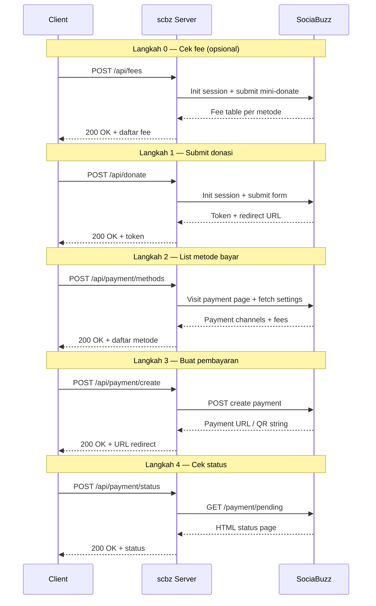

# scbz — Go SDK & Payment Gateway untuk SociaBuzz

[](https://pkg.go.dev/github.com/hirotomasato/scbz)
[](https://golang.org)
[]()

> **scbz** — *SociaBuzz* di-Go-kan. SDK dan REST gateway untuk platform donasi [SociaBuzz](https://sociabuzz.com).  
> 18 negara, 100+ metode pembayaran — e-wallet, bank transfer, kartu kredit, **USDT**, BTC, ETH, Binance Pay.

```go
import "github.com/hirotomasato/scbz/sociabuzz"
```

---

## 🌏 Sponsor

`🇮🇩 Indonesia` `🇲🇾 Malaysia` `🇸🇬 Singapore` `🇵🇭 Philippines` `🇹🇭 Thailand`  
`🇵🇰 Pakistan` `🇧🇩 Bangladesh` `🇱🇰 Sri Lanka`  
`🇦🇪 UAE` `🇸🇦 Saudi Arabia` `🇶🇦 Qatar`  
`🇳🇬 Nigeria` `🇿🇦 South Africa`  
`🇬🇧 UK` `🇩🇰 Denmark`  
`🇦🇺 Australia` `🇳🇿 New Zealand`  
`🇺🇸 United States`

---

## 📦 Package

```bash
go get github.com/hirotomasato/scbz
```

---

## 🏗️ Arsitektur

```
scbz/
├── sociabuzz/              # Go SDK — 2.650 baris
│   ├── client.go           # SociaBuzz, Donation, Payment — OOP flow
│   ├── http.go             # HTTP client: cookie jar, CSRF, 6 endpoints
│   ├── fees.go             # FeeCalculator — cek fee tanpa donasi
│   ├── constants.go        # 18 negara + group labels
│   ├── models.go           # Semua struct data & DTO
│   ├── errors.go           # 5 error types
│   └── json.go             # Helpers JSON
├── server/                 # REST API gateway
│   ├── config.go           # Env-driven settings
│   ├── auth.go             # API key middleware (Bearer/X-API-Key/query)
│   ├── schemas.go          # Request/response JSON structs
│   ├── session.go          # Session store: Memory atau SQLite
│   ├── webhook.go          # Background poller + HMAC signature
│   └── routes/             # Handler per endpoint
│       ├── donate.go       # POST /api/donate
│       ├── fees.go         # POST /api/fees + GET /api/fees/countries
│       └── payment.go      # POST /api/payment/{methods,create,status}
└── cmd/
    ├── main.go             # CLI smoke test
    └── scbz-server/        # Server entry point (chi router)
```

---

## 🔄 Alur Donasi



---

## 🚀 Quick Start (SDK)

```go
package main

import (
    "context"
    "fmt"
    "github.com/hirotomasato/scbz/sociabuzz"
)

func main() {
    ctx := context.Background()
    sb := sociabuzz.New("https://sociabuzz.com")

    // Langkah 1 — Submit donasi
    donation, err := sb.Donate(ctx, "creator_username", 10000, "Indonesia",
        "Budi", "budi@email.com", "Semangat!")
    if err != nil { panic(err) }
    defer donation.Close()

    // Langkah 2 — Lihat metode bayar + fee
    methods, _ := donation.GetPaymentMethods(ctx)
    for _, m := range methods {
        fmt.Printf("#%d %-20s fee=%s pay=%s\n", m.ID, m.Label, m.Fee.TotalFee, m.Fee.TotalPay)
    }

    // Langkah 3 — Pilih metode dan dapatkan payment URL
    payment, _ := donation.CreatePayment(ctx, "gopay")
    fmt.Println("Redirect user ke:", payment.PaymentURL)

    // Langkah 4 — Poll status
    status, _ := payment.CheckStatus(ctx)
    fmt.Println("Status:", status)
}
```

### Cek Fee Saja (tanpa membuat donasi)

```go
calc := sociabuzz.NewFeeCalculator("https://sociabuzz.com", "creator")
estimates, _ := calc.Estimate(ctx, "Indonesia", 10000, "creator")
for _, e := range estimates {
    fmt.Printf("%-20s %s fee=%s pay=%s\n", e.Label, e.Currency, e.Fee.TotalFee, e.Fee.TotalPay)
}
calc.Close()
```

---

## 🚀 Quick Start (Server)

```bash
git clone https://github.com/hirotomasato/scbz
cd scbz

export SOCIABUZZ_USERNAME=creator_kamu
export API_KEY=rahasia123
go run ./cmd/scbz-server/
# → http://localhost:8000
```

### Test dengan curl

```bash
# Cek fee GoPay untuk donasi Rp10.000
curl -X POST http://localhost:8000/api/fees \
  -H "Content-Type: application/json" \
  -d '{"country":"Indonesia","amount":10000,"username":"creator"}'

# Submit donasi
curl -X POST http://localhost:8000/api/donate \
  -H "Content-Type: application/json" \
  -d '{"username":"creator","amount":10000,"country":"Indonesia","fullname":"Budi","email":"budi@test.com"}'
```

---

## 📋 API Reference

Semua endpoint `POST` dan `GET` — request/response JSON.

### `POST /api/fees` — Cek Fee

Cek biaya transaksi per metode pembayaran sebelum donasi. **Tidak ada yang ditagih.**

| Field | Type | Required | Default |
|-------|------|----------|---------|
| `country` | string | ✅ | — |
| `amount` | number | ✅ | — |
| `username` | string | | `SOCIABUZZ_USERNAME` |

```json
// Request
{"country":"Indonesia","amount":10000,"username":"msdigital"}

// Response (200)
{
  "success": true,
  "country": "Indonesia",
  "currency": "IDR",
  "amount": 10000,
  "methods": [
    {
      "id": 1,
      "name": "gopay",
      "label": "Gopay",
      "group": "E-Wallet",
      "gateway": "midtrans",
      "fee": {
        "fee_type": "percent",
        "fee_rate": 0.02,
        "total_fee": "204",
        "total_pay": "10,204",
        "min_amount": 1000,
        "max_amount": 5000000
      }
    }
  ],
  "total": 23
}
```

### `POST /api/donate` — Submit Donasi

| Field | Type | Required | Description |
|-------|------|----------|-------------|
| `username` | string | ✅ | Creator username |
| `amount` | number | ✅ | Nominal donasi |
| `country` | string | ✅ | Negara — currency otomatis |
| `fullname` | string | ✅ | Nama donatur |
| `email` | string | ✅ | Email donatur |
| `note` | string | | Pesan |
| `callback_url` | string | | Webhook callback |

```json
// Request
{"username":"msdigital","amount":10000,"country":"Indonesia",
 "fullname":"Budi","email":"budi@test.com","note":"Semangat!"}

// Response (200)
{
  "success": true,
  "token": "e1125eb6-bd41-11f1-bb82-cee239a73494",
  "country": "Indonesia",
  "currency": "IDR",
  "amount": 10000,
  "redirect_url": "https://sociabuzz.com/payment/x/e1125eb6-...",
  "expires_in": 3600
}
```

### `POST /api/payment/methods` — List Metode Bayar

```json
{"token":"e1125eb6-bd41-11f1-bb82-cee239a73494"}
```

### `POST /api/payment/create` — Buat Pembayaran

```json
{"token":"e1125eb6-...","payment_method":"gopay"}
```

```json
{
  "success": true,
  "payment_method": "gopay",
  "label": "Gopay",
  "gateway": "midtrans",
  "payment_url": "https://app.midtrans.com/snap/v4/redirection/...",
  "inv_id": "TRIBE-IDR-261001-..."
}
```

### `POST /api/payment/status` — Cek Status

```json
{"token":"e1125eb6-...","inv_id":"TRIBE-IDR-...","payment_method":"gopay"}
// → {"success":true,"token":"...","status":"pending"}
```

### `GET /api/fees/countries` — Daftar Semua Negara

```json
{
  "success": true,
  "total": 18,
  "countries": [
    {"country":"Indonesia","currency":"IDR","iso2":"ID"},
    {"country":"Malaysia","currency":"MYR","iso2":"MY"},
    ...
  ]
}
```

---

## 🔔 Webhook

Kalau `callback_url` disertakan saat donate, server polling status tiap `WEBHOOK_POLL_INTERVAL` detik. Ketika status terminal tercapai (`paid`/`expired`/`failed`), POST ke `callback_url`:

```json
{
  "event": "payment.paid",
  "token": "uuid",
  "inv_id": "TRIBE-IDR-...",
  "payment_method": "gopay",
  "status": "paid",
  "timestamp": 1700000000
}
```

Header `X-Webhook-Secret` + `X-Webhook-Signature` (HMAC-SHA256) dikirim jika `WEBHOOK_SECRET` diset.

---

## ⚙️ Environment Variables

| Variable | Default | Description |
|----------|---------|-------------|
| `SOCIABUZZ_BASE_URL` | `https://sociabuzz.com` | Base URL SociaBuzz |
| `SOCIABUZZ_USERNAME` | — | Creator username **(required)** |
| `API_KEY` | — | API key untuk auth |
| `API_KEYS` | — | Extra keys (comma-separated) |
| `SESSION_BACKEND` | `sqlite` | `sqlite` atau `memory` |
| `SESSION_DB_PATH` | `scbz_sessions.db` | Path SQLite |
| `WEBHOOK_ENABLED` | `true` | Aktifkan webhook |
| `WEBHOOK_POLL_INTERVAL` | `5` | Detik antar poll |
| `WEBHOOK_TIMEOUT` | `3600` | Timeout per payment |
| `WEBHOOK_SECRET` | — | Secret untuk HMAC |
| `API_HOST` | `0.0.0.0` | Bind address |
| `API_PORT` | `8000` | Port |

---

## 💳 Metode Pembayaran per Negara

> **Catatan:** Metode yang tersedia tergantung **negara akun creator**, bukan negara donor.
> Creator Indonesia → metode Indonesia (GoPay, OVO, DANA, QRIS, bank, kartu).
> Creator US/Malaysia → metode negara tsb + **USDT/crypto** via TripleA.

### 🇮🇩 Indonesia — 23+ metode (tested live ✅)

| # | Metode | Key | Gateway | Fee |
|---|--------|-----|---------|-----|
| 1 | **GoPay** | `gopay` | midtrans | 2% |
| 2 | OVO | `ovo` | xendit | 1.67% |
| 3 | DANA | `dana` | xendit | 1.67% |
| 4 | ShopeePay | `shopeepay_idr` | 2c2p | 2.22% |
| 5 | **QRIS** | `qris` | xendit | 0.7% |
| 6–17 | Bank Transfer (BCA, Mandiri, BRI, BNI, dll) | — | xendit/midtrans | flat ~4.440–4.975 |
| 18–23 | Retail Outlet (Indomaret, Alfamart, dll) | — | xendit | flat 5.500–14.000 |
| 24–26 | Credit Card / Google Pay / Apple Pay | — | stripe | ~3.5% |
| — | **USDT / Crypto** | `usdt` | triplea | 1% *(butuh creator luar negeri)* |

### 🇲🇾 Malaysia — 13 metode
Touch n Go, GrabPay, ShopeePay, FPX, Credit Card, **BTC/ETH/USDT/USDC/Binance**

### 🇸🇬 Singapore — 8 metode
PayNow QR, GrabPay, **BTC/ETH/USDT/USDC/Binance**

### 🇵🇭 Philippines — 16 metode
GCash, Paymaya, GrabPay, ShopeePay, QR Ph, Bank Redirect, **Crypto**

### 🇹🇭 Thailand — 12 metode
PromptPay QR, LINE Pay, TrueMoney, ShopeePay, Bank, **Crypto**

### 🇺🇸 United States + 12 negara lain
Credit Card + Google Pay + Apple Pay + **BTC/ETH/USDT/USDC/PYUSD/Binance** via TripleA (1%)

> Detail fee lengkap: lihat `curl -X POST /api/fees` dengan country tujuan.

---

## 📝 Lisensi

MIT — bebas pakai, modifikasi, distribusi.

---

## 🇮🇩 Bahasa Indonesia

**scbz** adalah Go SDK untuk menerima donasi via SociaBuzz. Cocok untuk content creator Indonesia.

### Cara Pakai

```bash
export SOCIABUZZ_USERNAME=nama_creator
export API_KEY=buat_key_acak
go run ./cmd/scbz-server/
```

```bash
# Cek fee GoPay untuk donasi Rp10.000
curl -X POST http://localhost:8000/api/fees \
  -H "Content-Type: application/json" \
  -d '{"country":"Indonesia","amount":10000}'
```

```go
// SDK langsung
sb := sociabuzz.New("https://sociabuzz.com")
donation, err := sb.Donate(ctx, "creator", 10000, "Indonesia", "Budi", "budi@test.com", "")
```

### 💰 Tabel Fee Indonesia (live)

| Metode | Fee | Minimal | Maksimal |
|--------|-----|---------|----------|
| GoPay | 2% | Rp1.000 | Rp5.000.000 |
| OVO | 1,67% | Rp1.000 | Rp20.000.000 |
| DANA | 1,67% | Rp1.000 | Rp20.000.000 |
| **QRIS** | **0,7%** | Rp1.000 | Rp10.000.000 |
| BCA | flat Rp4.975 | Rp10.000 | Rp50.000.000 |
| Credit Card | ~3,5% | — | — |
| **USDT / Crypto** | **1%** | *creator luar negeri* | |

> 💡 **Mau USDT?** Cukup ganti `country` ke Malaysia/US/Singapore saat donasi —  
> atau bikin akun SociaBuzz di negara yang support TripleA.

---

## ⚠️ Disclaimer

SDK ini **tidak resmi** — dibuat dengan reverse-engineer dari alur donasi publik SociaBuzz.  
Tidak ada afiliasi dengan SociaBuzz. Perubahan upstream bisa merusak SDK tanpa peringatan.  
Gunakan dengan risiko sendiri (lihat [LICENSE](LICENSE)).

---

<div align="center">
  <sub>Dibuat dengan ☕ oleh <a href="https://github.com/hirotomasato">@hirotomasato</a></sub>
</div>
---

## 🚢 Deploy (fork pgscbz)

Perubahan di fork ini dibanding upstream:
- Server menolak start kalau `API_KEY` kosong (kecuali `ALLOW_NO_AUTH=true`, hanya untuk tes lokal).
- `PORT` dibaca otomatis (Railway, Render, dll), `API_PORT` tetap menang kalau diisi.
- `Dockerfile` (build statis tanpa CGO, jalan sebagai user non-root, data SQLite di `/data`).

```bash
docker build -t scbz .
docker run -d --name scbz --restart unless-stopped -p 8000:8000 \
  -e SOCIABUZZ_USERNAME=username_creator_kamu \
  -e API_KEY=$(openssl rand -hex 24) \
  -v scbz-data:/data scbz
curl localhost:8000/health
```

Di PaaS: deploy repo ini dengan Dockerfile, isi `SOCIABUZZ_USERNAME` dan `API_KEY`, pasang volume di `/data`.
Jangan buka port ke publik tanpa HTTPS; `API_KEY` satu-satunya pengaman. Lihat `.env.example`.
